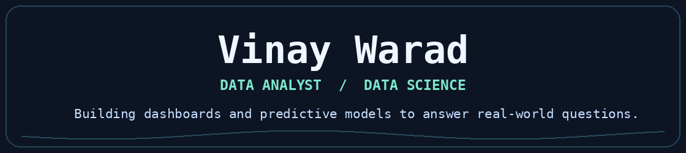
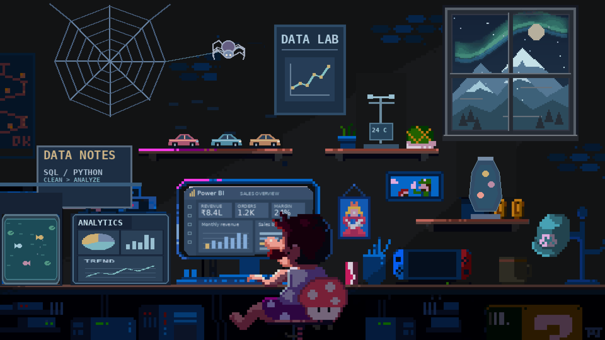

## About Me

I’m a data analyst and a Computer Science Engineering graduate specializing in Data Science. I turn messy data into clear findings that help people make decisions.

I use Python, SQL, and Excel to clean and analyze data, and Power BI to build dashboards that make trends easy to spot.

## Approach

My work philosophy centers on three principles.

**Curiosity** · I ask why and test my assumptions with data.

**Clean Data** · I check for errors and inconsistencies so my analysis is reliable.

**Clear Communication** · I explain what the data shows and what to do next.

## Projects

<table>
  <tr>
    <td width="50%">
      <strong>Traffic Accident Black Spot Prediction</strong> 
      Cleaned historical accident data and used machine learning to identify locations with a higher risk of crashes. 
      <strong>Stack</strong> · Python · Machine learning
    </td>
    <td width="50%">
      <strong>E-commerce Data Cleaning &amp; Analysis</strong> 
      Audited e-commerce order and returns data, removed duplicate records, and prepared clean datasets for sales and returns analysis. 
      <strong>Stack</strong> · Python · Pandas · NumPy · Excel
    </td>
  </tr>
  <tr>
    <td width="50%">
      <strong>Clothing Virtual Try-On</strong> 
      Explored how a flow-based generative network can align a garment with a person’s photo to produce a realistic clothing preview. 
      <strong>Stack</strong> · Computer vision · Flow-based generative network
    </td>
    <td width="50%">
      <strong>Cotton Plant Disease Prediction</strong> 
      Preprocessed and augmented cotton leaf images, then trained and evaluated a convolutional neural network to classify leaf diseases. 
      <strong>Stack</strong> · Python · TensorFlow/Keras · OpenCV · scikit-learn
    </td>
  </tr>
</table>

## Technology Stack

<table>
  <tr>
    <td align="center"> <strong>Python</strong></td>
    <td align="center"> <strong>Pandas</strong></td>
    <td align="center"> <strong>Excel</strong></td>
    <td align="center"> <strong>MySQL</strong></td>
    <td align="center"> <strong>Power BI</strong></td>
    <td align="center"> <strong>Tableau</strong></td>
    <td align="center"> <strong>NumPy</strong></td>
  </tr>
  <tr>
    <td align="center"> <strong>Matplotlib</strong></td>
    <td align="center"> <strong>Seaborn</strong></td>
    <td align="center"> <strong>scikit-learn</strong></td>
    <td align="center"> <strong>TensorFlow</strong></td>
    <td align="center"> <strong>OpenCV</strong></td>
    <td align="center"> <strong>Git</strong></td>
    <td align="center"> <strong>Jupyter</strong></td>
  </tr>
</table>

## GitHub Metrics

## Contribution Snake

## Connect

[GitHub](https://github.com/vinaywarad) · [LinkedIn](https://www.linkedin.com/in/vinaywarad/) · [waradvinay123@gmail.com](mailto:waradvinay123@gmail.com)

